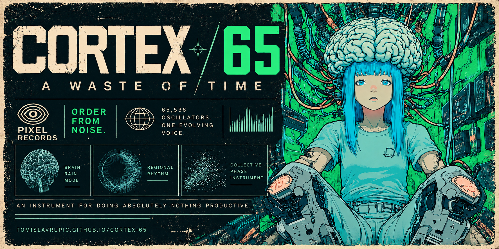

# CORTEX / 65



A playable generative instrument: 65,536 coupled phase states, an anatomical point-cloud display, sixteen musical regions and a bounded 4/8/16-voice audio bank. Apple Silicon AU and standalone app, with a browser companion.

**[Play in the browser](https://tomislavrupic.github.io/cortex-65/)** · **[Download Mac AU + app](https://github.com/tomislavrupic/cortex-65/releases/tag/v0.3.0)**

Click the cortex to start the field and excite that spot, or use Start Field and press E. Regional pulses recruit linked regions; Brainstorm lights up broad bursts, while Brain Rain scatters softer isolated drops. ADSR shapes spatial spread and decay. Scale Lock, note variation and octave range create tuned evolving patterns; Free permits continuous pitches. Reverb adds long tails.

Head Orbit gives each sounding voice a moving headphone position with analytic ear-timing and head-shadow cues. Rate and Depth control the movement. Binaural beat mode instead sends matched sine pairs to separate ears with a 2–50 Hz difference. The two modes are separately selected. Use stereo headphones.

Open Advanced to name, save and load your own `.cortex65.json` patches. Files restore musical controls while preserving transport and the evolving phase state. Exact stochastic trajectories are not saved.

## Browser

Serve `dist` over HTTPS or localhost, or run `Launch-Browser.command` on Mac. Modern Web Audio, AudioWorklet, Web Workers and WebGL are required. Tap Start Field to enable audio; after an operating-system interruption another tap may be needed. Safari/iPhone compatibility was reviewed in source only for this release; physical-device audio playback remains unverified. Try 4 voices on slower phones.

No accounts, telemetry or external runtime assets. Computation and sound run on your device. The 65,536 slow states drive a much smaller sound bank; this is not 65,536 simultaneous audio-rate voices.

## Mac

Requires Apple Silicon and macOS12+. Unpack the Mac ZIP. The standalone app is in `Native`; `Install-AU.command` installs the Audio Unit into your user Components folder, backing up any existing Cortex component. Rescan Audio Units in the DAW. MIDI notes seed regional excitation.

The recommended 0.3.0 Mac archive is Developer ID signed and Apple notarized, with validated stapled tickets for the app and AU. The original ad-hoc archive remains available as a historical asset. No Intel or VST3 binary is included. See `dist/releases/0.3.0-notarized.json` for the submission ID and final archive checksum.

## Build and verify

```sh
git clone --recurse-submodules https://github.com/tomislavrupic/cortex-65.git
cd cortex-65
cmake -S native -B native/build -DCMAKE_BUILD_TYPE=Release
cmake --build native/build --config Release -j2
ctest --test-dir native/build --output-on-failure
cd dist
for test in *-check.mjs; do node "$test"; done
```

The release source ZIP already includes the pinned JUCE dependency. See `native/README.md` for native build details. The browser and native engines implement the same instrument concept but are not sample-identical. Automated render/allocator tests and AU validation are separate from physical DAW listening.

## Anatomy and model

BodyParts3D, © The Database Center for Life Science licensed under CC Attribution 4.0 International. The points are sampled from cerebral hemisphere surfaces; musical regions, phase evolution, color and excitation waves are instrument-design layers, not measured neural firing or atlas labels. See `assets/anatomy/` and the in-app Model Notes for provenance. To reproduce extraction, download the original BodyParts3D4.0 OBJ archive from the credited source into `assets/anatomy/source/`; it is not duplicated in this repository.

## License

Product source: GNU AGPLv3, see LICENSE. JUCE uses its AGPLv3 option, pinned to `2cdfca8feb300fb424002ba2c2751569e5bacb64`. See THIRD_PARTY_NOTICES.md and the asset attributions. Release archives include corresponding source and checksums.

## Factory bank

Choose a patch under Factory Presets and press Load. Orbital Rain adds slow headphone motion to scattered droplets; Cortical Thunder creates broad Brainstorm bursts. Deep Current is a low evolving fifths bed, Glass Canopy is sparse major-key rain, and Slow Bloom is a warm spreading ambient pattern. The original D Major Drift remains available. New patches enable their pulse patterns but preserve play/pause and mute; press Start Field if paused. All factory patches use the eight-voice budget. Headphones reveal the orbital motion. Loading replaces musical settings, so save a personal patch first if you want to keep it.

The website starts at A2 /110Hz. The five new factory patches use roots one octave above their initial bank and zero detune. Binaural beats tune the left/base voice, then apply the selected Hz offset to the right ear; Scale Lock does not quantize that offset. Use Head Orbit for spatial movement of tuned voices. The original D Major Drift snapshot retains its saved register.

Clicking the cortex starts/resumes browser audio and excites the picked point; dragging rotates without starting playback. Download beside the instrument name opens the Mac download page in a separate tab.

## Artwork

The website uses the approved portrait poster and a matching landscape version for X/Open Graph previews. Both are downloadable from the [website](https://tomislavrupic.github.io/cortex-65/downloads.html#artwork). The portrait is the user-supplied original; the landscape was recomposed with OpenAI built-in image generation. The final prompt and asset hashes are in `dist/assets/marketing/`. Original banner artwork is retained.
